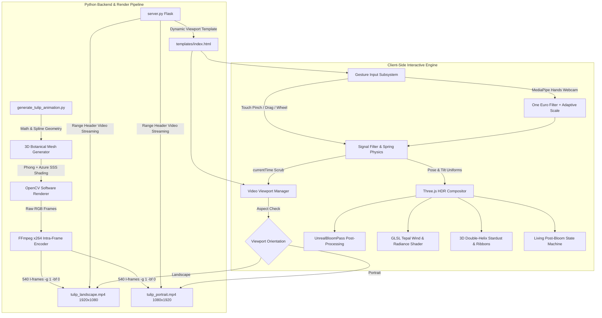

# Product Requirements Document (PRD): Blue Tulip 3D Botanical Animation & Gesture Web App

**Project Title:** Blue Tulip 3D Botanical Animation (*Tulipa*, Stylized Sapphire Cultivar)  
**Repository:** `d:\flower2_python-main`  
**Target Audience:** AI Developer Agents, Botanical Visualizers, Interactive Web Engineers  
**Document Status:** Complete / Production Specification (v2.4.0)  
**Version:** 2.4.0  

---

## 1. Executive Summary & Vision

The **Blue Tulip 3D Botanical Animation** project is a hybrid computational graphics system combining:
1. **Offline Procedural 3D Botanical Rendering Engine (`Python / NumPy / OpenCV / FFmpeg`)**:
   - Generates high-fidelity, mathematically authentic 3D blooming sequences of Blue Tulips (*Tulipa*, stylized sapphire-blue cultivar) on a light ivory studio backdrop.
   - Simulates 14 caulescent stems + 18 coaxial peduncle necks with receptacle domes, and 29 broad glaucous leaves with V-crease & S-curves via cubic Bézier splines & Bishop transport frames.
   - Models 18 flower heads (15 open layered blooms + 3 closed 6-tepal imbricate buds) with explicit receptacle `R` and axis `A` attachment planning and camera-facing hero flower (`dir=[0.08, 0.22, 0.97]`, scale `1.28`).
   - Anatomically layered flowers: 9 tepals per open flower (3 outer + 3 inner + 3 smaller ruffled petaloids) pre-solved at $K=14$ opening poses (`P_states`) for length-preserving unfolding without vertex-lerp shrinkage, 6 golden bilobed anthers with orange-gold pollen beads, golden filaments, and central slimmer 3-lobed pistil (`#CFE8C8`).
   - Two-sided sapphire pigment (`tepal_colors()`: royal/cobalt body, azure/cyan ridges, indigo folds, pale translucent rim, fine striations, warm basal glow on inner side) with azure-leaning `PETAL_SSS_TINT`, 0.55px quad seam expansion, growth wavefront glow, soft cast bouquet shadow, golden pollen shimmer, and subtle highlight bloom.
2. **Interactive Zero-Lag Web Showcase (`Flask / Three.js r183 / GLSL / MediaPipe / GSAP`)**:
   - Fullscreen responsive viewport with multi-aspect switching (`tulip_landscape.mp4` for PC/desktop, `tulip_portrait.mp4` for mobile/portrait).
   - Keyframe-dense all-intra H.264 video rendering (`-g 1 -bf 0`) enabling frame-accurate scrubbing without browser decoding stutter.
   - Dual-mode gesture control: Touch/pointer pinch & drag + real-time AI camera hand tracking (`MediaPipe Hands`) smoothed via **One Euro Filter** and damped spring physics.
   - Real-time 3D HDR WebGL compositor with blue-hue isolation, `UnrealBloomPass`, double-helix sapphire/gold stardust spiral, soft Fresnel volumetric ribbons, GLSL tepal breeze deformation, and living post-bloom background aurora gradients.

---

## 2. Core Architecture & System Topology



---

## 3. Component Breakdown & Functional Specifications

### 3.1 Procedural 3D Botanical Renderer (`generate_tulip_animation.py`)

- **File Path:** [generate_tulip_animation.py](file:///d:/flower2_python-main/generate_tulip_animation.py)
- **Primary Modules & Mathematics:**
  - **Cluster & Attachment Architecture:** 14 caulescent Bézier stems using Bishop transport frames. Every head has an explicit receptacle point `R` and axis `A` in `build_tulip_scene()`. Terminal stems are retargeted (`p3` re-aimed, chord `0.19` for flowers / `0.14` for buds) so stem + coaxial peduncle neck (`generate_tulip_stem(..., cap_radius, cap_len)`) land on `R` with a receptacle dome inside the tepals. Branch flowers sprout necks from parent stem nodes.
  - **Growth Sync (v2.4.0):** Terminal neck starts at `parent.surf_t1 - 0.10`; branch neck at `parent.surf_t1 - 0.50`; neck duration `0.95s`; head start = `max(head_t0_min, neck_t0 + neck_dur - 0.10)`. Consequently, accent bud on stem 7 starts ~0.5s later than v2.3.
  - **Foliage (Leaves):** 29 broad glaucous leaves with central V-crease, S-curves, tip curls, and glaucous sheen Fresnel (`#2A5C3C` to `#86B467` with blue-white powder bloom).
  - **Flower Heads (18 Total):**
    - 15 open layered blooms + 3 closed 6-tepal imbricate buds (old teardrop `generate_tulip_bud` removed; buds use `generate_tulip_tepal(..., max_openness=0.0)`).
    - Hero flower facing camera (`dir=[0.08, 0.22, 0.97]`, scale `1.28`).
    - 3-layer depth of field: `bg` (sigma `3.2`), `fg` (sigma `2.4`), and sharp `mid` specimens.
  - **Flower Anatomy:**
    - 9 tepals per open flower: 3 outer (`52x55`), 3 inner (`52x55`), 3 smaller ruffled petaloids (`30x33`). Midline solved by integrating bend angle `phi(U)` and pre-computed at $K=14$ opening poses (`P_states`), interpolated at render time.
    - Two-sided pigment (`tepal_colors()`): outer surface (cobalt/royal body, azure/cyan ridges, indigo folds, green basal flush, pale rim) and inner surface (indigo/cobalt/royal/azure/violet, midrib, warm basal glow, fine striations). `compute_lighting(..., sss_tint=PETAL_SSS_TINT)` gives azure-leaning edge translucency.
    - 6 golden bilobed anthers with orange-gold pollen beads (`3.6 * scale` px) on golden filaments (`r = 0.0060 * scale`, `length = 0.200 * scale`), plus slimmer central 3-lobed pistil (`length = 0.135 * scale`, `#CFE8C8`).
  - **Finishing & Quality Passes:**
    - 0.55px quad seam expansion (`q_x_exp`, `q_y_exp`) eliminating hairline render cracks.
    - Growth wavefront `rim_glow` and `wave_particles` along advancing surface edges.
    - Soft cast bouquet shadow on backdrop, 58 ambient dust motes, 12 delicate bokeh discs, golden pollen shimmer (`POLLEN_PER_FLOWER = 16`), 28 drifting two-sided sapphire tepals, and subtle highlight bloom (`> 226.0` subject highlights).
  - **Light Studio Backdrop:**
    - Configurable `--backdrop`: `ivory` (default: `(250, 244, 232)` center, `(221, 207, 187)` edge, `(206, 190, 168)` floor), `pearl`, or `champagne`, with light triangular dither (`+/- 0.5` LSB).
  - **Stage Mapping (0.0s - 18.0s):**
    - `Stage 1 (0.0s - 3.0s)`: Stem elongation and basal leaf unfurling.
    - `Stage 2 (3.0s - 6.0s)`: Coaxial peduncle neck & imbricate 6-tepal bud formation.
    - `Stage 3 (6.0s - 9.0s)`: 9-tepal goblet unfolding via `P_states` with two-sided pigment & azure SSS.
    - `Stage 4 (9.0s - 13.0s)`: Golden stamens & 3-lobed pistil visible; anthers dehisce with pollen shimmer.
    - `Stage 5 (13.0s - 18.0s)`: Full anthesis, orbital camera rotation, drifting two-sided sapphire tepals.
  - **FFmpeg Encoding:**
    - Arguments: `-c:v libx264 -preset medium -pix_fmt yuv420p -crf 18 -g 1 -bf 0 -movflags +faststart`.
    - 540 all-intra frames (I-frames) for zero-latency seeking in both orientations.

### 3.2 Streaming Web Server (`server.py`)

- **File Path:** [server.py](file:///d:/flower2_python-main/server.py)
- **Framework:** Python Flask.
- **Endpoints:**
  - `GET /`: Renders `templates/index.html` with cache-control headers (`no-cache, no-store, must-revalidate`).
  - `GET /video`: Responsive video stream.
  - `GET /video/landscape`: Serves [tulip_landscape.mp4](file:///d:/flower2_python-main/tulip_landscape.mp4) with HTTP 206 Partial Content range support.
  - `GET /video/portrait`: Serves [tulip_portrait.mp4](file:///d:/flower2_python-main/tulip_portrait.mp4) with HTTP 206 Partial Content range support.
  - `GET /preview/<filename>`: Serves keyframe image previews.

### 3.3 Interactive Client Engine (`templates/index.html`)

- **File Path:** [templates/index.html](file:///d:/flower2_python-main/templates/index.html)
- **Signal Filtering & Gesture Physics:**
  - One Euro Filter (`minCutoff = 1.15 Hz`, `beta = 0.085`, `dCutoff = 1.0 Hz`).
  - Damped spring physics ($k = 110, d = 19$).
  - Chromium seek queue protection (`scheduleSeek`).
- **WebGL2 HDR Compositor & Visual Effects:**
  - `HalfFloatType` render targets with `UnrealBloomPass` (strength 0.88, radius 0.55, threshold 0.78).
  - Background GLSL shader: Blue-hue isolation gated with saturation ($\ge 0.26$) and luma ($\ge 0.08$).
  - 3D Double-Helix Stardust (860 particles) + Volumetric Fresnel Ribbons + 3D Floating Blue Tulip Tepals.

---

## 4. Key Assets & Directory Structure

```text
d:\flower2_python-main\
├── generate_tulip_animation.py    # Procedural 3D botanical animation engine & CLI (v2.4.0)
├── generate_tulip_animation_v23_backup.py
├── play.py                        # Desktop OpenCV video viewer
├── server.py                      # Flask HTTP server with video range streaming
├── verify_metrics.py              # Automated connectivity, encode contract, and stability checks
├── templates\
│   └── index.html                 # Single-page WebGL, MediaPipe, GSAP interactive UI
├── tulip_landscape.mp4            # 1920x1080 All-Intra H.264 video (540 I-frames, 44.5 MB)
├── tulip_portrait.mp4             # 1080x1920 All-Intra H.264 video (540 I-frames, 45.2 MB)
├── requirements.txt               # Python package dependencies
├── README.md                      # End-user documentation and setup instructions
└── prd.md                         # Project Requirements Document (this document)
```

---

## 5. Acceptance Test Criteria & Metrics

> Note: Legacy dark-scene numeric luma/saturation targets from v2.3 do not apply to the v2.4.0 light ivory studio look and are not measured here.

| Metric | Target Specification | v2.4.0 Measurement |
| :--- | :--- | :--- |
| **All-Intra Frames** | 540 I-frames (`-g 1 -bf 0 -crf 18`), h264, `moov` < `mdat` | `tulip_landscape.mp4`: 540/540 I-frames (44.5 MB); `tulip_portrait.mp4`: 540/540 I-frames (45.2 MB) |
| **Temporal Stability** | Mean abs frame diff max $\le 1.5$ | Landscape: med 0.27, p99 0.94, max 1.07, max luma jump 0.99; Portrait: med 0.83, p99 1.30, max 1.31, max luma jump 0.93 |
| **Geometry Connectivity** | 18/18 heads, 18/18 necks, neck start < 0.01 from parent axis, 0 timing violations | 18/18 heads, 18/18 necks, max parent-axis offset `0.00130`, 0 timing violations |
| **Flower Anatomy** | 9 tepals (3 outer, 3 inner, 3 petaloid), 6 stamens, 1 pistil per open flower | Compliant |

---

## 6. CLI & Execution Reference

```bash
# 1. Install Dependencies
pip install -r requirements.txt

# 2. Run Automated Connectivity, Encode & Stability Checks
python verify_metrics.py --videos

# 3. Run Interactive Web Server
python server.py
# Access at: http://localhost:5000

# 4. Render New Full Animation Sequence (Landscape & Portrait)
python generate_tulip_animation.py --aspect landscape --out tulip_landscape.mp4
python generate_tulip_animation.py --aspect portrait --out tulip_portrait.mp4

# 5. Export Keyframe Preview PNGs
python generate_tulip_animation.py --preview
```
