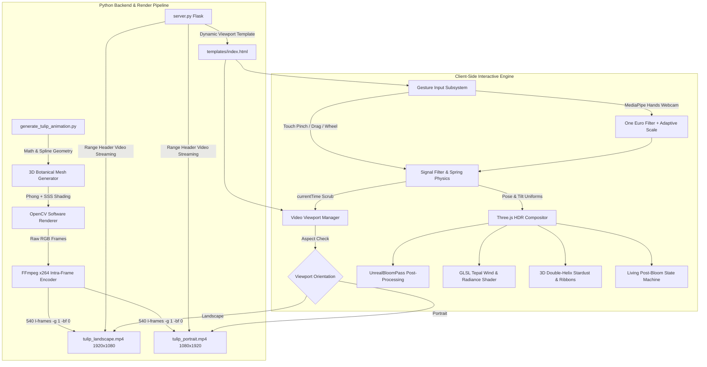

# Product Requirements Document (PRD): Blue Tulip 3D Botanical Animation & Gesture Web App

**Project Title:** Blue Tulip 3D Botanical Animation (*Tulipa*, Stylized Sapphire Cultivar)  
**Repository:** `d:\flower2_python-main`  
**Target Audience:** AI Developer Agents, Botanical Visualizers, Interactive Web Engineers  
**Document Status:** Complete / Production Specification  
**Version:** 2.2.0  

---

## 1. Executive Summary & Vision

The **Blue Tulip 3D Botanical Animation** project is a hybrid computational graphics system combining:
1. **Offline Procedural 3D Botanical Rendering Engine (`Python / NumPy / OpenCV / FFmpeg`)**:
   - Generates high-fidelity, mathematically authentic 3D blooming sequences of Blue Tulips (*Tulipa*, stylized sapphire-blue cultivar).
   - Simulates stem and leaf growth via Bézier splines & Bishop transport frames, teardrop bud expansion, and 6-tepal anthesis with subsurface scattering (SSS) approximations, longitudinal venation, 6 golden-amber stamens (#E8B923), central 3-lobed pistil, and ambient particles.
2. **Interactive Zero-Lag Web Showcase (`Flask / Three.js r183 / GLSL / MediaPipe / GSAP`)**:
   - Fullscreen responsive viewport with multi-aspect switching (`tulip_landscape.mp4` for PC/desktop, `tulip_portrait.mp4` for mobile/portrait).
   - Keyframe-dense all-intra H.264 video rendering (`-g 1 -bf 0`) enabling frame-accurate scrubbing without browser decoding stutter.
   - Dual-mode gesture control: Touch/pointer pinch & drag + real-time AI camera hand tracking (`MediaPipe Hands`) smoothed via **One Euro Filter** and damped spring physics.
   - Real-time 3D HDR WebGL compositor with a double-helix sapphire/gold stardust spiral, soft Fresnel volumetric ribbons, GLSL tepal breeze deformation, tepal edge luminescence, and living post-bloom background aurora gradients (midnight navy, teal, sapphire, violet).

---

## 2. Core Architecture & System Topology



---

## 3. Component Breakdown & Functional Specifications

### 3.1 Procedural 3D Botanical Renderer (`generate_tulip_animation.py`)

- **File Path:** [generate_tulip_animation.py](file:///d:/flower2_python-main/generate_tulip_animation.py)
- **Primary Modules & Mathematics:**
  - **Stem Cluster Architecture:** 7 slender, organic Bézier splines generated using Bishop transport frames for non-twisting normal vector continuity, rising from a common base along the reference diagonal silhouette.
  - **Foliage (Leaves):** 14 lanceolate leaves with central longitudinal crease and glaucous waxy sheen (#355C3A to #6E9B56).
  - **Flower Anatomy:**
    - 6 tepals arranged in two whorls (3 outer, 3 inner) with smooth ogee tips and subtle longitudinal venation.
    - 6 stamens with dehiscing golden anthers (#E8B923) and dark navy filament bases.
    - Central green-white pistil with 3-lobed stigma.
  - **Stage Mapping (0.0s - 18.0s):**
    - `Stage 1 (0.0s - 3.0s)`: Stem and basal leaf elongation rising diagonally.
    - `Stage 2 (3.0s - 6.0s)`: Teardrop bud formation with cyan/pale-green apex tint.
    - `Stage 3 (6.0s - 9.0s)`: 6 tepals separate outward from goblet cup with SSS edge translucency.
    - `Stage 4 (9.0s - 13.0s)`: Stamens & pistil visible; golden anthers dehisce with pollen.
    - `Stage 5 (13.0s - 18.0s)`: Full anthesis, orbital camera rotation, floating pollen and drifting sapphire tepals.
  - **Color Palette & Lighting:**
    - Hero Petal Base: #1F4FBF
    - Hero Petal Mid: #3B7BE8
    - Hero Petal Edge/Highlight: #8FC3FF
    - Petal Throat / Deep Base: #0B2A7A
    - Anthers / Pollen: #E8B923
    - Background: Radial vignette from midnight navy #050B1F to indigo edge #01030A.
  - **FFmpeg Encoding:**
    - Arguments: `-c:v libx264 -pix_fmt yuv420p -crf 18 -g 1 -bf 0 -movflags +faststart`.
    - 540 all-intra frames (I-frames) for zero-latency seeking in both orientations.

### 3.2 Streaming Web Server (`server.py`)

- **File Path:** [server.py](file:///d:/flower2_python-main/server.py)
- **Framework:** Python Flask (threaded).
- **Network Boundaries:**
  - Host binding: `0.0.0.0`, Port: `5000`.
  - On Windows environments, local server processes must be launched with unsandboxed permissions to enable external browser access.
- **Endpoints:**
  - `GET /`: Renders `templates/index.html` with cache-control headers (`no-cache, no-store, must-revalidate`).
  - `GET /video`: Legacy alias returning responsive video stream.
  - `GET /video/landscape`: Serves [sakura_landscape.mp4](file:///d:/flower2_python-main/sakura_landscape.mp4) with HTTP 206 Partial Content range support.
  - `GET /video/portrait`: Serves [sakura_portrait.mp4](file:///d:/flower2_python-main/sakura_portrait.mp4) with HTTP 206 Partial Content range support.
  - `GET /preview/<filename>`: Serves keyframe image previews from `./previews/`.

### 3.3 Interactive Client Engine (`templates/index.html`)

- **File Path:** [templates/index.html](file:///d:/flower2_python-main/templates/index.html)
- **Viewport Ergonomics:**
  - CSS-first zero-margin layout with `touch-action: none` preventing native scroll and pinch-zoom collisions.
  - Target touch sizing strictly `>= 44px` on buttons and sliders for mobile compliance.
  - Dynamic aspect detection on `window.resize` and `orientationchange`.

#### 3.3.1 Signal Filtering & Gesture Physics Pipeline
- **One Euro Filter (`OneEuroFilter`)**:
  - `minCutoff = 1.15 Hz`, `beta = 0.085`, `dCutoff = 1.0 Hz`.
  - Removes high-frequency jitter during resting hand poses while preserving fast tracking responsiveness during rapid gestures.
- **Spring Physics (`stepSpring`)**:
  - Stiffness $k = 105 - 115$, Damping $d = 18.5 - 19.0$.
  - Interpolates target bloom aperture and hand 3D coordinates `(x, y, roll)` at display refresh rates (60Hz–120Hz).
- **Chromium Seek Queue Protection (`scheduleSeek`)**:
  - Throttles video frame seeks with `!video.seeking` and `|currentTime - target| > 0.012s` to prevent decoding lockups.

#### 3.3.2 Gesture Recognition Modes
1. **Touchscreen Pinch & Drag:**
   - 2-finger distance delta mapped to bloom timeline across `BLOOM_START_SEC = 3.2s` to `BLOOM_END_SEC = 15.0s`.
   - 1-finger drag and desktop mouse scrub mapped with directional weighting.
2. **AI Hand Tracking (`MediaPipe Hands`):**
   - Dynamically loaded CDN scripts: `@mediapipe/hands` and `@mediapipe/camera_utils`.
   - Normalization metric: Wrist (landmark 0) to Middle MCP (landmark 9) establishes dynamic palm scale invariant to camera distance.
   - Gesture metric: Blended 62% Thumb-to-Index pinch aperture + 38% 4-finger spread extension.
   - Hand tilt and center `(x, y)` directly steer the 3D WebGL spiral and camera projection.

#### 3.3.3 Three.js HDR Compositor & Visual Effects
- **WebGL2 Canvas:** `HalfFloatType` render targets with `EffectComposer`, `RenderPass`, `UnrealBloomPass`, and `OutputPass`.
- **Background GLSL Shader:**
  - Converts video texture to Linear RGB (`pow(c, 2.2)`).
  - Isolates rose-pink floral chromaticity and petal luminance.
  - Applies procedural multi-octave wind displacement to bloomed petals.
  - Multi-scale background sparkle fields with star cross-rays and soft bokeh discs.
  - Soft radial floral luminescence radiating outward from petal boundaries.
- **3D Stardust Double-Helix:**
  - 860 particles categorized into fine micro-stardust, out-of-focus lens bokeh orbs, and 4-point hero anamorphic star glints.
  - Rotates and twists dynamically in response to user gestures.
- **Volumetric Glowing Ribbons:**
  - Dual Catmull-Rom 3D spline tubes (`TubeGeometry`) with Gaussian view-normal Fresnel falloff, preventing harsh polygon wire edges.
- **Living Post-Bloom State (`BLOOMED_ALIVE`):**
  - Triggers automatically when bloom $\ge 78\%$ and settles for $>0.45\text{s}$.
  - Holds flower in full bloom while animating petal wind sway, 42 floating translucent petals, and background aurora gradients until the user makes a new intentional gesture.

---

## 4. Key Assets & Directory Structure

```text
d:\flower2_python-main\
├── generate_sakura_animation.py   # Procedural 3D botanical animation engine & CLI
├── server.py                      # Flask HTTP server with video range streaming
├── templates\
│   └── index.html                 # Single-page WebGL, MediaPipe, GSAP interactive UI
├── sakura_landscape.mp4           # 1920x1080 All-Intra H.264 video (540 frames, ~27.4 MB)
├── sakura_portrait.mp4            # 1080x1920 All-Intra H.264 video (540 frames, ~39.8 MB)
├── previews\                      # Keyframe PNG exports from procedural renderer
├── requirements.txt               # Python package dependencies
├── README.md                      # End-user documentation and setup instructions
└── prd.md                         # Project Requirements Document (this document)
```

---

## 5. Non-Functional Requirements & Performance Budgets

| Metric | Target | Implementation Detail |
| :--- | :--- | :--- |
| **Video Scrub Latency** | $< 16\text{ms}$ | Full intra-frame x264 encoding (`-g 1 -bf 0`), all frames are I-frames. |
| **WebGL Framerate** | $60 - 120\text{ FPS}$ | Single-pass shader composition, low draw-call count, instanced points. |
| **Hand Tracking Latency**| $< 35\text{ms}$ | MediaPipe Hands modelComplexity 1, 320x240 capture resolution. |
| **Touch Hit Area** | $\ge 44\text{px} \times 44\text{px}$ | Compliant with Apple HIG and Android Material guidelines. |
| **GitHub Asset Limit** | $< 100\text{ MB}$ per file | Video files tuned to ~27 MB (landscape) and ~40 MB (portrait). |
| **Cross-Platform Support**| Desktop & Mobile | Chromium, Safari iOS, Firefox, Edge; touch and camera fallbacks. |

---

## 6. CLI & Execution Reference

```bash
# 1. Install Dependencies
pip install -r requirements.txt

# 2. Run Interactive Web Server
python server.py
# Access at: http://localhost:5000

# 3. Render New Full Animation Sequence (Optional)
python generate_sakura_animation.py --aspect landscape
python generate_sakura_animation.py --aspect portrait

# 4. Run Standalone Desktop OpenCV Player
python generate_sakura_animation.py --play
```

---

## 7. Knowledge Guidelines for AI Developer Agents

When modifying or extending this codebase, adhere to the following rules:
1. **Video Encoding Invariance:** Never re-encode MP4 files with default long-GOP settings (`-g 250`). Any new video export must maintain `-g 1 -bf 0 -crf 18` to preserve zero-lag HTML5 gesture scrubbing.
2. **Color Space Consistency:** The procedural video is mastered in sRGB; the Three.js pipeline converts samples to Linear RGB for physical bloom math before output tonemapping.
3. **Gesture State Deadband:** Hand-tracking modifications must respect the `BLOOMED_ALIVE` anchor deadbands (`0.068` aperture change, `0.24` translation) to avoid jitter disrupting the living post-bloom aura.
4. **Touch Target Sizing:** Maintain minimum `44px` height/width boundaries on all interactive elements in `templates/index.html`.

